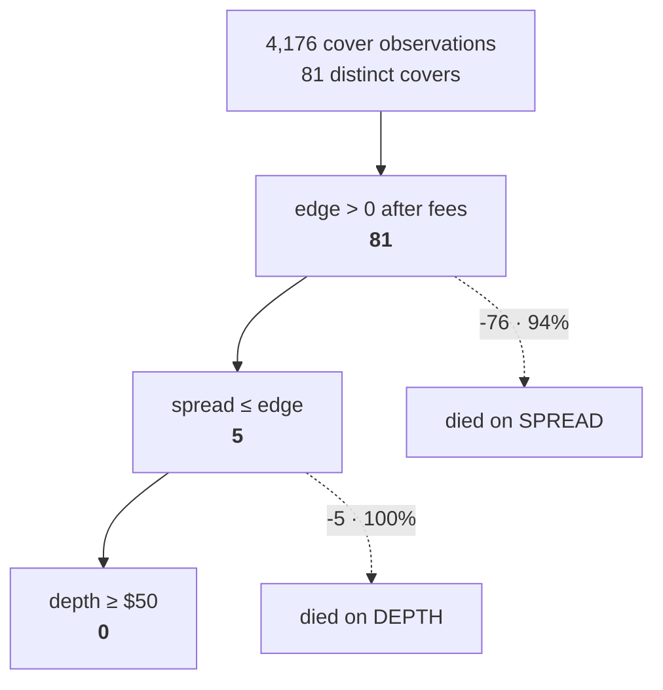

# ArbitrageModel (v3.5 rebuild)

A Kalshi / Polymarket / SX Bet **paper-trading arbitrage measurement
instrument**. It watches the same event priced on multiple venues, flags
opportunity classes (same-venue `ARB`, cross-venue `XSPREAD`, `NEGRISK`
baskets, `POLITICAL` intra-market, `+EV` vs de-vigged consensus — shipped
frozen), and maintains an honest, append-only flat-$1 paper ledger answering
one question: *"How much would I have made by today if I'd bet $1 on every
flag?"*

**It never places orders.** Read `SPEC.md` (the full v3.5 spec), `CLAUDE.md`
(the 13 hard rules), and `PREREGISTRATION.md` (frozen hypotheses and gates)
before touching anything.

---

## Results

**The instrument has answered its question. Neither side of the spread pays.**

Every barrier people assume kills retail prediction-market arbitrage turned out
to be an engineering problem that yielded. The one that did not yield is the
one nobody talks about: you cannot get *size* on the mispricing that exists.

### Scale of the measurement

| | |
|---|---|
| observation window | 2026-07-08 → 2026-08-09 (32 days) |
| quotes persisted | **65,769,105** |
| polls | 94,742 |
| opportunities flagged | 240,606 |
| paper positions booked | 308 |
| Odds API credits spent | 0 (venues are keyless) |

### What was solved, and what was not

| barrier | verdict | evidence |
|---|---|---|
| settlement divergence | **solved** | 9 adjudicated pairs share one BLS release |
| detection | **works** | 240,606 flags; 4,176 cover observations |
| observation speed | **solved** | PM WebSocket is **156×** REST (935 vs 6 updates / 360 s) |
| inter-leg skew | **solved** | **0.27 s** achieved vs a 10 s actionable bound |
| **spread** | **binding** | kills 76 of 81 covers (94%) |
| **depth** | **binding** | kills the remaining 5 |

### The taker funnel — 2026-07-30 → 08-09, every gate



Five covers **did** clear the spread — the first time anything has. Every one
then failed the depth floor:

| edge | half-spread sum | ratio | min leg depth | realizable |
|---|---|---|---|---|
| 0.02535 | 0.02500 | 0.99× | $0.43 | $0.01 |
| 0.01734 | 0.01000 | 0.58× | $16.84 | **$0.29** |
| 0.01289 | 0.01150 | 0.89× | $9.00 | $0.12 |
| 0.01309 | 0.00550 | 0.42× | $0.26 | $0.00 |
| 0.02196 | 0.00550 | **0.25×** | $11.67 | $0.26 |

One carried an edge **four times its spread**. The mispricing is real. It is
also worth about a quarter, roughly once every two days, against a $50 floor
that exists because anything thinner cannot be filled on two venues at once.

> The useful form of the negative is not "no arb exists". It is: *the arb is
> real, rare, and unsizeable.*

### The maker side — measured twice, independently

If crossing the spread costs more than the edge, the escape is to *earn* it.
Two lanes measure this on different venues by different methods, and agree:

| lane | venue | method | n | estimate (95% CI) | verdict |
|---|---|---|---|---|---|
| **L7** | Kalshi | hourly candles, conservative fill | 103,879 | −0.0164 [−0.0201, −0.0127] | SIGNAL adverse |
| **L12** | Polymarket | WebSocket tape, real trade prints | 169 | −0.0567 [−0.1013, −0.0120] | SIGNAL adverse |

L12 brackets queue position explicitly, because it is unobservable —
conservative assumes we are *last* in queue, optimistic assumes *first*. Both
bounds are negative. **The optimistic bound is the one that matters:** it says
the loss is not a queue artifact. Even with perfect priority a resting order
fills exactly when the market is about to move against it. That is adverse
selection — whoever lifts your bid knows something, and on average it is worth
more than the spread you earned.

### Three things that are structurally impossible

Not "rare" — impossible, and cheaper to prove than to keep polling for:

| claim | evidence |
|---|---|
| Kalshi cannot produce a same-venue ARB | `NO_ask ≡ 1 − YES_bid` in **400,000 of 400,000** paired observations, so `YES_ask + NO_ask = 1 + spread`. Minimum ever seen: **1.0100**. It is arithmetic; no polling cadence finds it. |
| Polymarket same-venue is not exploitable | **214,386** touch updates across 25 contested liquid markets: **0 covers**. Tightest sum 1.0200 net of the 2% taker fee — i.e. **exactly 1.0000 gross**. Books are held complementary to the cent; the fee is the wall. |
| SX positions cannot be exited | **722,617** SX quotes carry **zero** bids. Every "clean" same-venue ARB the model ever flagged was SX, and none could have been unwound. |

`NEGRISK` baskets are likewise correctly blocked: 5,966 failed the
exhaustiveness proof on `venue-flag-missing`, and spot-checking three against
the live API confirmed Kalshi genuinely reports `mutually_exclusive=false`
(`KXFED-27MAR` is 18 overlapping threshold markets, not a partition).

### Non-sports matching

Haiku proposes, a human adjudicates, and code decides anything code can decide
(rule 11). Precision against the human-curated set: **1.0** (TP=9, FP=0, FN=0,
TN=248, n=257).

The lane's most useful output was a *rejection*. Kalshi and Polymarket both
list "highest temperature in Austin" — and settle it differently:

| venue | settlement source |
|---|---|
| Kalshi | NWS **Climatological Report (Daily)** — QC'd midnight-to-midnight |
| Polymarket | **Wunderground** station page (KAUS) — max over METAR observations |

Same airport, two published products. A 1 °F disagreement flips a 2 °F bucket
outright. The model called them the same measurand at 0.92–0.95 confidence
*with both rulebooks in front of it*, so settlement source is now decided in
code, before the model is asked: **156 of 573 candidates die on source conflict
alone**, and the surviving real pairs number **9**.

### Cost

| | |
|---|---|
| Odds API credits | **0** — all three venues are public and keyless |
| Anthropic (Haiku matcher) | **$0.86** for 1,462 verdicts |
| everything else | electricity |

---

## Setup

```bash
python3.13 -m venv .venv && source .venv/bin/activate   # 3.11+ works
pip install -r requirements.txt
cp .env.example .env      # optional: add ODDS_API_KEY (free, the-odds-api.com,
                          # 500 credits/mo) — consensus/EV machinery no-ops
                          # gracefully without it
pytest -q                 # must be green — rule 13: nothing runs otherwise
python -m arb report      # empty frame + DB creation sanity check
```

No key is required for the three venues (all public keyless GETs) or the MLB
Stats settlement oracle. The Odds API key powers `arb scan` (consensus) and
non-MLB score settlement only. When you add one, record a real fixture on the
first `arb scan` and replace the synthetic `tests/fixtures/oddsapi_h2h.json`
(see `data/verified_facts.md`).

## Run

```bash
caffeinate -i python -m arb supervisor    # macOS; the ONLY sanctioned way to run loops
python -m arb status                      # heartbeats, quote age, backups, open bets
cat reports/daily/$(date +%F).md          # the product — written 23:59 America/New_York
```

- `caffeinate -i` does not survive lid-close or battery — on a laptop set
  `sudo pmset -b sleep 0 disablesleep 1` or run headless/plugged-in. Better:
  install a launchd/systemd unit with `KeepAlive` pointing at
  `python -m arb supervisor`.
- The supervisor owns all loops (one-shot `watch --once` children, relaunched
  each `watch_interval_secs`) and the clock (`scan_times`, `settle_time`,
  `daily_report_time`, daily DB backup, weekly shape-check, monthly canary).
- A second supervisor refuses to double-run (`.locks/`).

**Stop / restart:**

```bash
touch data/stop-all       # halts every loop between cycles (in-flight cycles finish)
# restart procedure (rule 13): commit, pytest -q green, then:
rm data/stop-all && caffeinate -i python -m arb supervisor
```

A fix that is not committed does not exist — children stamp `head_sha` into
their heartbeats so a stale process is visible in `arb status` instantly.

## Commands

| Command | Purpose |
|---|---|
| `watch [--once] [--dry-run]` | primary loop: fetch → match → detect → track → persist |
| `scan` | Odds API consensus refresh (no-op if disabled / no key) |
| `settle [--manual EVENT RESULT -y]` | resolve pending bets; auto-runs reconcile + check-invariants |
| `report [--daily DATE]` | recompute any day idempotently from raw rows |
| `status` | supervisor state, data freshness alarm, backup age, open bets |
| `check-invariants` | the six ledger invariants; silent when clean |
| `negrisk-scan` | Polymarket negRisk basket scan (both sides, exhaustiveness proof) |
| `political` | Polymarket-only intra-market YES+NO<1 lane |
| `verify` | 10s flash re-quote of fresh locked flags (vanish rate + paper fill oracle) |
| `bench [--pull] [--probe-anj] [--only L6,L8]` | score and rank every `STRATEGIES.md` lane on the data we hold; `--pull` refreshes the keyless Kalshi settled corpus (0 credits), `--probe-anj` spends ~2 credits on the L9 overround probe |
| `dashboard` | read-only instrument panel on `http://127.0.0.1:8722` (config `dashboard.*`) |
| `canary` | synthetic fixture through the full pipeline; P&L must match to the cent |
| `shape-check` | live response schema vs recorded fixtures |
| `covers --since ISO` | cover-survival funnel over a window: edge → spread → depth → lifetime, i.e. what WOULD have paid |
| `pm-tape [--record-secs N]` | record the Polymarket WebSocket book tape (keyless) and print the maker bracket |
| `backup` | `VACUUM INTO` a dated snapshot in `backups/` (`db_backup.keep_last`, default 2) |

## Reading the daily report

`reports/daily/YYYY-MM-DD.md` (committed to git — versioned evidence; CSVs
stay ignored):

- **Headline** = trusted + sports + pregame + clean lane only, optimistic
  basis, **gross of carry**. Everything else (review lane, non-sports,
  micro/live/AI-matched, XSPREAD) prints in its own section, never blended.
- **Missed confirmations count $0** in the confirmed column next to the miss
  rate — never silently dropped (the V1 survivorship artifact).
- **Left on the table** shows every filtered flag by reason — the filters'
  cost is measured, not assumed.
- **Cadence line**: planned vs actual poll interval (p95 is the loop's real
  spec; V1 believed 60s while running ~140s).
- A restated day (pending bets settled later) is marked `*`.

## What to expect

**Zero clean settled evidence is the correct outcome, and it is what happened.**
See [Results](#results). Cross-venue XSPREADs are REVIEW-only forever by
default; the EV lane is frozen. The real deliverables were always the honesty
metrics — flagged vs realized edge, cadence, left-on-table — and the
pre-registered verdicts in `PREREGISTRATION.md`. Everything nulled out, so the
instrument did its job at the cost of electricity.

If you extend this, two failure modes bit repeatedly and are worth internalising
before trusting any new number:

1. **A null read as a fact.** Opportunity legs carried no `bid` field, so a
   spread gate silently tested *"was this serialized"* rather than *"is the
   spread wider than the edge"* — and reported all 64 covers unexecutable from a
   missing column. The same shape had already happened once with `depth_usd or
   0` turning `None` into `0`. When a gate rejects everything, suspect the gate.
2. **False precision.** Clustering maker fills by token widened the CI enough to
   flip "excludes zero" into "straddles zero". Repeated observations of the same
   market are not independent; the unit of analysis is the market, not the fill.

## Adding a lane

`STRATEGIES.md` is the lane catalogue and `arb/bench_lanes.py:LANES` the
registry. A lane returns a `LaneResult` carrying its pre-registered primary, the
independent unit of analysis, `n`, an estimate with a CI, and a verdict; the
bench ranks by decisiveness per Odds API credit. Lanes below
`bench.n_min_units` are reported but never scored — an underpowered mean must
not read like a finding, which is why `arb pm-tape` prints `NOT SCORED` rather
than a number when `n` is short.

## Layout

See `SPEC.md` §5. One eligibility predicate (`arb/eligibility.py`), one metrics
module (`arb/metrics.py`), one fee implementation (`arb/venues/fees.py`),
append-only ledger (`flat_bets` + `bet_events`) — all enforced by CI grep-tests
in `tests/test_hygiene.py`. `scripts/headline.sql` independently recomputes the
headline number; CI asserts it matches `metrics.py`.
